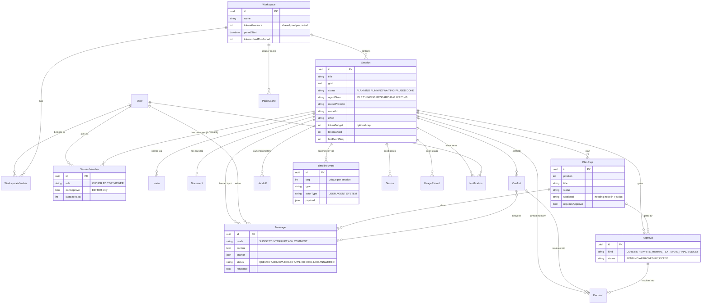

# Huddle: Database Design

PostgreSQL + Prisma. The full schema (validated with `prisma validate`) is in [`schema.prisma`](./schema.prisma). It moves to `apps/api/prisma/schema.prisma` when we scaffold.

## What lives where

| Data | Lives in | Why |
|---|---|---|
| Users, sessions, roles, plan, messages, approvals, decisions, timeline | **Postgres** | Relational, queried, and the record of truth |
| Document content + who wrote which text | **Yjs doc** (snapshot saved to `Document.ydocState`) | Live co-editing needs CRDTs. Human-text attribution is stored as marks inside the doc. |
| Presence (who's online, cursors, typing) | **In memory** (Socket.IO + Yjs awareness) | Short-lived. Never persisted. |

## ER diagram

## Key design decisions

1. **The timeline is append-only and has a gapless `seq` per session.** `seq` is allocated by atomically incrementing `Session.lastEventSeq` inside the same transaction as the insert. Clients reconnect with "give me everything after seq N." **Catch-up** is `events where seq > SessionMember.lastSeenSeq`, so we store no extra state.
2. **There is exactly one Owner per session.** Ownership is stored as `SessionMember.role = OWNER`, not as a `Session.ownerId` column, so there's a single source of truth. A partial unique index added in the migration SQL enforces it. A handoff swaps two roles in one transaction and writes a `Handoff` row. **Any workspace member can create a session** and becomes its Owner. The creator isn't stored on the session; it's the actor of the `SESSION_CREATED` event.
3. **Session roles are separate from app roles.** `User.role` (STANDARD/ADMIN, from the boilerplate) is for the whole app. `SessionMember.role` decides what someone can do inside a room.
4. **Human input is a `Message`, not just a timeline event.** The agent needs a queue with status (`QUEUED → ACKNOWLEDGED → APPLIED/DECLINED`, or `ANSWERED` for Asks). The timeline gets an event that *points to* the message.
5. **Every conflict and approval can become a `Decision`.** Pinned memory traces back to who decided what and why (`conflictId` / `approvalId`, both unique).
6. **Tokens come from a shared workspace pool.** Every session in a workspace draws from the workspace's `tokenAllowance` for the current period, whoever created or owns the session. The workspace (its admin) pays, so a handoff never changes who pays. `Workspace.tokensUsedThisPeriod` and `Session.tokensUsed` are cached sums of `UsageRecord`. `Session.tokenBudget` is an **optional cap** so one session can't drain the pool. Before every model call, check the pool first, then the session cap. In the MVP each user gets a personal workspace on signup, so the pool is effectively a personal spending limit. Per-member monthly limits are deferred.
7. **Notifications make up the "waiting on you" inbox.** They're written when an approval, question, conflict or handoff targets a specific person.
8. **The scraper cache is scoped to the workspace.** `PageCache` is keyed by (`workspaceId`, `sha256(url)`) with a 24-hour TTL, so teams never share fetched content. That matters if we later scrape pages behind a login. `Source` records which pages a given session cited.
9. **Deleting a session cascades** to everything it owns. Deleting a user cascades to memberships and notifications. Authored content keeps its foreign key, so deleting a user is restricted while they have authored content. That's acceptable for the MVP.
10. **Stored once, not twice.** A few facts were stored in two places and could contradict each other, so the copies were removed:
    - A decision's origin comes only from its links (`conflictId` / `approvalId` / neither). A check constraint prevents both being set.
    - A conflict is open while `resolvedAt` is null. There's no separate status column.
    - `canApprove` can only be true for Editors, enforced by a check constraint.
    - `Session.status = WAITING` is always changed in the same transaction that creates or resolves the blocking approval.
11. **Roles.**
    - `Role` (app-wide): ADMIN operates Huddle itself, and STANDARD is everyone else. Kept because the boilerplate's guard uses it.
    - `WorkspaceRole`: ADMIN manages members, the token pool, billing and deleting the workspace. MEMBER creates sessions and uses the pool. Unused in the MVP.
12. **Avatars are computed, not stored.** Initials come from the user's first and last name. The color comes from a hash of the user id.
13. **No Postgres enums.** Columns with a fixed set of values (roles, statuses, kinds, event types) are plain `varchar` strings. The allowed values are constants in `@huddle/shared`, and the API validates every write against them with zod. Adding, renaming or removing a value is a code change, never a migration. The trade-off is that the database itself won't reject a bad value, so all writes go through the validated API layer.
